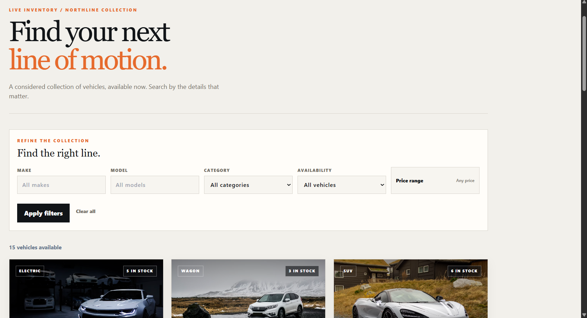
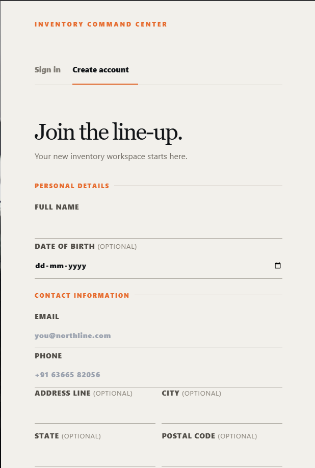
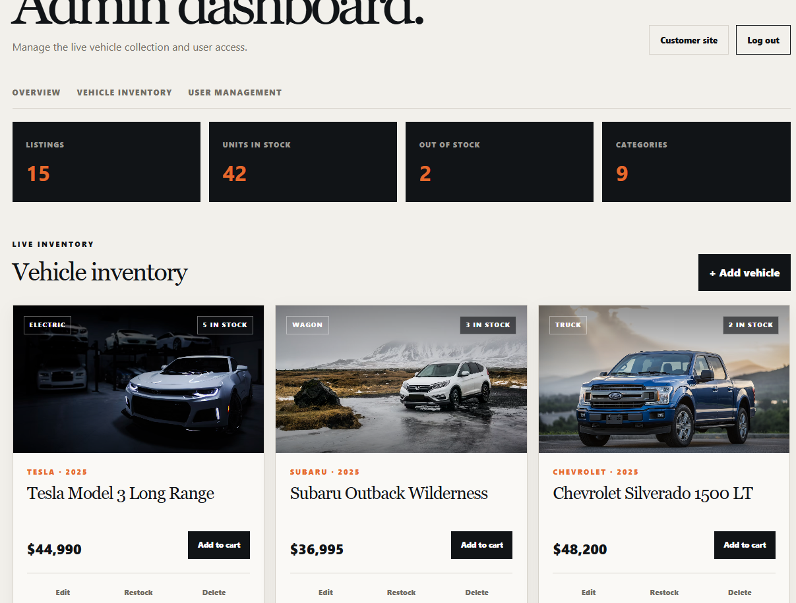
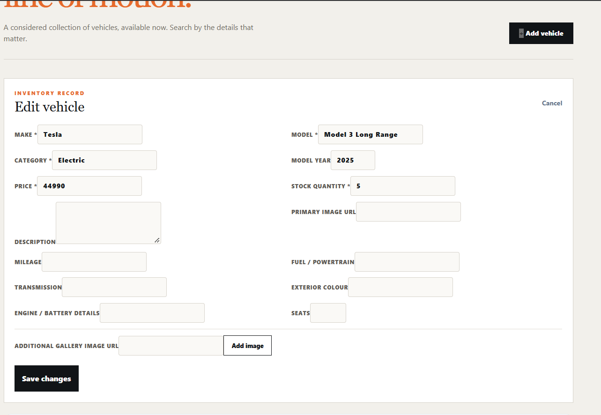
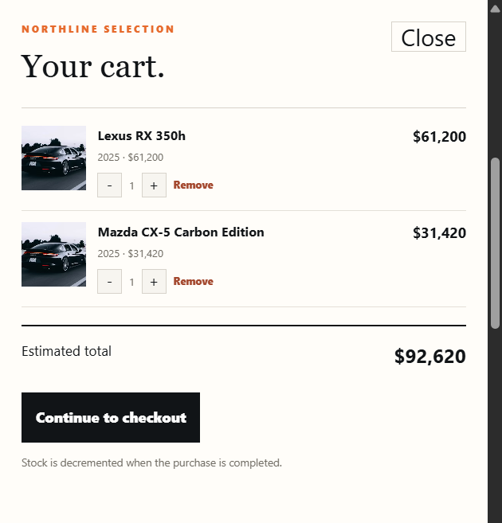
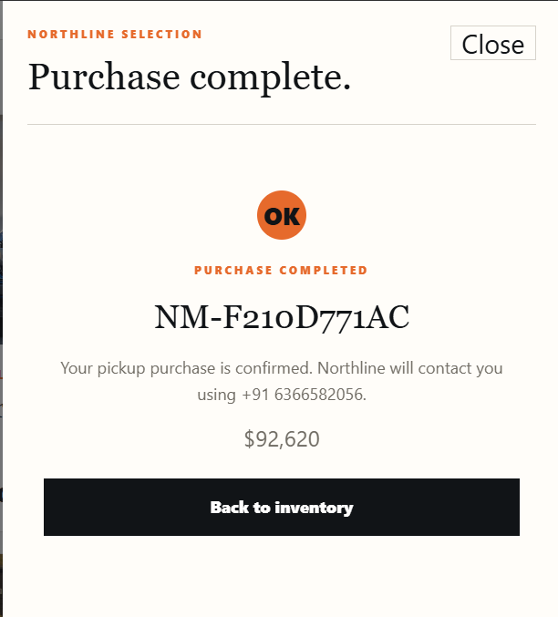
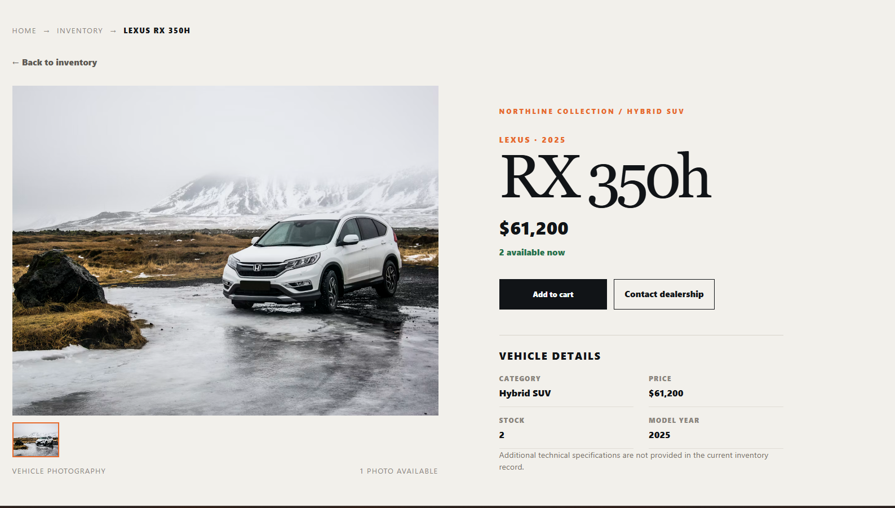
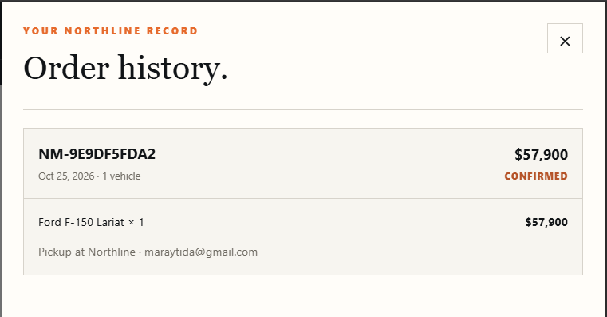

# Northline Motors

Northline Motors is a full-stack car dealership inventory system. It provides a React single-page application backed by an Express REST API, with Supabase PostgreSQL persistence, custom application authentication, JWT authorization, vehicle search, purchasing, and administrator inventory controls.

## Submission deliverables

| Requirement | Link |
|---|---|
| Public repository | [GitHub: lxkka21/NorthlineMotors](https://github.com/lxkka21/NorthlineMotors) |
| Project overview and local setup | [README setup instructions](#installation) |
| Final application screenshots | [Screenshots folder](./Screenshots) and embedded examples below |
| Test report | [test-report.md](./test-report.md) |
| AI usage statement | [My AI Usage](#my-ai-usage) |
| Raw AI logs / chat links | [PROMPTS.md](./PROMPTS.md) |
| Optional live application | [Live Northline Motors site](https://frontend-three-xi-99caku33l8.vercel.app) |

## Live website

| Resource | Link |
|---|---|
| Website | [Open Northline Motors](https://frontend-three-xi-99caku33l8.vercel.app) |
| Admin portal | [Open admin login](https://frontend-three-xi-99caku33l8.vercel.app/admin/login) |
| API health | [Check backend](https://backend-pi-five-51.vercel.app/api/health) |

The frontend and API are deployed separately on Vercel. Supabase stores the persistent application data. For local development, follow the setup steps below.

<p align="center"></p>

## Quick start

```powershell
npm install
npm run dev:backend
```

Open a second terminal and run:

```powershell
npm run dev:frontend
```

Then open `http://localhost:5173`. The backend runs at `http://localhost:3000`.

## Features

- User registration and login with Argon2id password hashing.
- JWT access tokens with configurable expiry.
- Server-side role enforcement for administrator operations.
- Two application roles: `admin` and `user`, with current database-backed authorization.
- Vehicle creation, listing, searching, updating, and administrator-only deletion.
- Atomic purchase operation that prevents overselling under concurrent requests.
- Persistent per-user cart with stock-aware quantities and immediate server-backed checkout.
- Historical order snapshots and authenticated order history.
- Administrator restocking with quantity validation.
- Responsive React/Tailwind SPA with loading, empty, success, and error states.
- Version-controlled SQL migrations for the database schema and inventory functions.
- Backend and frontend automated tests, TypeScript checks, ESLint, and production builds.

<p align="center"></p>

## Technology and architecture

| Layer | Technology |
|---|---|
| Frontend | React, TypeScript, Vite, Tailwind CSS |
| Backend | Node.js, TypeScript, Express 5, Zod, Argon2, JWT |
| Database | Supabase PostgreSQL via server-side `@supabase/supabase-js` |
| Testing | Vitest, Supertest, Testing Library, jsdom |

The backend owns authentication, authorization, validation, business rules, and database access. The frontend communicates with the backend REST API through a centralized typed API client. Supabase credentials are never bundled into the frontend.

```text
React SPA
   │ typed HTTP API client
   ▼
Express routes → controllers → services → repositories
                                      │
                                      ▼
                              Supabase PostgreSQL
```

## Prerequisites

| Requirement | Version / access |
|---|---|
| Node.js | 20+ recommended |
| npm | 10+ recommended |
| Database | Supabase project with authorized migration access |

## Installation

From the repository root:

```powershell
npm install
```

The repository contains `.env.example` with placeholder values only. Copy it to a private environment configuration and fill it using a secure secret store or local file. Do not commit the copy.

The existing private `supa.env` file uses these server-side variable names:

```text
SUPABASE_URL
SUPABASE_SECRET_KEY
SUPABASE_JWKS_URL
```

The backend also needs:

```text
JWT_SECRET
JWT_EXPIRES_IN_SECONDS
NODE_ENV
PORT
FRONTEND_ORIGIN
```

`JWT_SECRET` is an application signing secret and must be different from every Supabase credential. It must contain at least 32 characters. Generate one locally with:

```powershell
node -e "console.log(require('node:crypto').randomBytes(32).toString('base64url'))"
```

The frontend may use only:

```text
VITE_API_BASE_URL
```

Never prefix Supabase secret or service-role credentials with `VITE_`. Never put them in frontend source, browser storage, screenshots, logs, or documentation.

### Roles and initial administrator setup

| Role | Permissions |
|---|---|
| `user` | Register, browse/search inventory, purchase available stock, view own orders |
| `admin` | All user actions plus vehicle CRUD, restocking, user listing, and role assignment |

Public registration always creates `user`; submitted roles are ignored. The backend reloads the current role on protected requests, so revoked permissions do not survive an old JWT.

The initial administrator is provisioned through a local, server-side command rather than public registration. Set the values only in the private backend process environment, apply the role migration first through an authorized database process, and remove the variables immediately afterward:

```powershell
$env:ADMIN_EMAIL='first-admin@example.com'
$env:ADMIN_PASSWORD='<private-password-at-least-12-characters>'
$env:ADMIN_PROVISION_CONFIRM='I_UNDERSTAND_INITIAL_ADMIN_PROVISIONING'
npm --workspace backend run provision:admin
Remove-Item Env:ADMIN_EMAIL,Env:ADMIN_PASSWORD,Env:ADMIN_PROVISION_CONFIRM
```

The command refuses to run without the confirmation token and refuses to create an administrator if one already exists. Never put these values in source, the frontend, shell history, or documentation.

Public registration is the safe way to create a normal User account. Sign out from the account menu before testing another role; each login reads the current role from the backend.

<p align="center"></p>

For evaluator access, use an administrator account provisioned through the protected server-side command above. The administrator email may be shared through a private handoff, but the password must not be committed to this public README. If an admin account is not available, provision one locally with a new private password rather than using a shared credential.

<p align="center"></p>
<p align="center"></p>

## Running locally

Start the backend:

```powershell
npm run dev:backend
```

The backend development and production start scripts automatically propagate `--use-system-ca` to the actual Node child process, which is required in environments where the Supabase TLS chain is trusted by the system certificate store. Do not disable TLS verification with `NODE_TLS_REJECT_UNAUTHORIZED=0`.

The API listens on `http://localhost:3000` by default. Health check:

```text
GET http://localhost:3000/api/health
```

Start the frontend in a second terminal:

```powershell
npm run dev:frontend
```

The Vite development server normally runs at `http://localhost:5173`.

## Database initialization

SQL migrations are stored in `database/migrations` and must be applied in filename order:

1. `001_initial_schema.sql`
2. `002_user_table_compatibility.sql`
3. `003_atomic_inventory_operations.sql`
4. `004_three_application_roles.sql`
5. `005_orders_checkout_and_vehicle_year.sql`
6. `006_profiles_and_vehicle_details.sql`
7. `007_two_application_roles.sql`
8. `008_confirmed_purchases.sql`

They create or configure:

- `public.users`, including case-insensitive email uniqueness, password hashes, roles, and timestamps.
- `public.vehicles`, including non-negative price/stock constraints and search indexes.
- Row-level security on both application tables.
- `purchase_vehicle(uuid)`, an atomic conditional decrement function.
- `restock_vehicle(uuid, integer)`, a validated inventory increment function.
- `orders` and `order_items`, with server-priced historical snapshots.
- `create_order(...)`, an atomic, idempotent checkout function that locks inventory and calculates totals.

The repository does not currently include an automated Supabase CLI migration runner. Apply these files only through an authorized deployment process or to a dedicated test project. Do not run them against production until the target project, existing tables, and migration plan have been reviewed. No live Supabase migration was applied for the verification recorded in this repository.

### Demo inventory seed

`backend/src/scripts/seed-demo-vehicles.ts` contains 15 fixed-ID demo vehicles across multiple categories and price ranges, including one zero-stock vehicle. It selects the fixed IDs first and inserts only missing rows; it never updates, deletes, truncates, or resets existing vehicles.

The configured Supabase project is the dedicated Northline Motors demo project. The command still requires both an explicit demo-target marker and a confirmation token as a local safety check. Configure the private `supa.env` with the intended server-side values, then run:

```powershell
$env:SUPABASE_DATABASE_TARGET='demo'
$env:SEED_CONFIRM='I_UNDERSTAND_DEMO_DATABASE'
npm --workspace backend run seed:demo
Remove-Item Env:SUPABASE_DATABASE_TARGET,Env:SEED_CONFIRM
```

Review the printed target hostname and planned insert count before running the command. Run it only against the dedicated demo project. Running it again is idempotent and reports zero new inserts while leaving existing records unchanged.

### Cart and checkout

The cart is stored under a key scoped to the authenticated user, so browser refreshes and account switches do not mix carts. Quantities are limited by available inventory and repeated lines for the same vehicle are merged. Checkout sends only vehicle IDs and quantities to the backend; Supabase reads trusted prices and stock, creates the order and historical item snapshots in one transaction, and uses an idempotency key to make retries safe. No card details or payment claims are collected; the purchase is confirmed immediately as an inventory purchase.

<p align="center"></p>
<p align="center"></p>

Migration `005_orders_checkout_and_vehicle_year.sql` must be applied after migrations 001–004 before using `/api/orders` against Supabase. Until then, the existing vehicle endpoints remain available but live checkout and order history are not configured.

## API

Unless stated otherwise, protected endpoints require:

```http
Authorization: Bearer <jwt>
```

Errors use this shape:

```json
{
  "error": {
    "code": "VALIDATION_ERROR",
    "message": "Request validation failed"
  }
}
```

### Authentication

#### `POST /api/auth/register`

Creates a regular user. The request cannot select an administrator role.

```json
{
  "email": "user@example.com",
  "password": "a-long-password-of-12-chars"
}
```

Response: `201 Created`

```json
{
  "user": { "id": "user-id", "email": "user@example.com", "role": "user" },
  "token": "<jwt>"
}
```

#### `POST /api/auth/login`

```json
{
  "email": "user@example.com",
  "password": "a-long-password-of-12-chars"
}
```

Response: `200 OK` with the same `user` and `token` structure.

#### `GET /api/auth/me`

Requires authentication. Returns the authenticated public user without a password hash.

### Vehicles

All vehicle endpoints require authentication. Vehicle input uses `make`, `model`, `category`, `price`, and `quantityInStock`. Text fields are trimmed; price and quantity must be non-negative.

<p align="center"></p>

#### `POST /api/vehicles`

Creates a vehicle. Response: `201 Created`.

```json
{
  "make": "Toyota",
  "model": "Corolla",
  "category": "Sedan",
  "price": 24999.99,
  "quantityInStock": 4
}
```

#### `GET /api/vehicles`

Returns `{ "vehicles": [...] }`. Optional query parameters are `make`, `model`, `category`, `minPrice`, and `maxPrice`.

#### `GET /api/vehicles/search`

Uses the same filters as the list endpoint and returns `{ "vehicles": [...] }`. Search values are safely escaped before being passed to Supabase filters.

#### `PUT /api/vehicles/:id`

Updates one or more vehicle fields. Requires at least one valid field. Returns `200 OK` or `404` for a missing vehicle.

#### `DELETE /api/vehicles/:id`

Administrator only. Returns `204 No Content` when deletion succeeds.

### Inventory

#### `POST /api/vehicles/:id/purchase`

Requires authentication. Atomically decreases stock by exactly one. It returns the updated vehicle, `404` for a missing vehicle, and `409` when stock is zero.

#### `POST /api/vehicles/:id/restock`

Administrator only. Request body:

```json
{ "quantity": 10 }
```

Quantity must be a positive integer no greater than 1,000,000. Returns the updated vehicle.

### Orders

#### `POST /api/orders`

Authenticated users complete a purchase with `customerName`, `contact`, `fulfillment` (`pickup` or `delivery`), an `idempotencyKey`, and unique `items` containing `vehicleId` and positive `quantity`. Prices and totals come from the database, not the browser; orders are immediately `confirmed`.

#### `GET /api/orders`

Returns the authenticated customer's orders. Administrators may view all orders; other users cannot access another customer's records.

#### `GET /api/orders/:id`

Returns one owned order or an administrator-visible order. Cancellation is not exposed because no cancellation/stock-restoration workflow is implemented.

<p align="center"></p>

### User management

#### `GET /api/auth/users`

Administrator only. Returns public user records without password hashes.

#### `PATCH /api/auth/users/:id/role`

Administrator only. Request body must be one of `{ "role": "admin" }` or `{ "role": "user" }`. An administrator cannot change their own role, and the database function prevents demoting the last administrator under concurrent requests.

## Testing and verification

Run linting:

```powershell
npm run lint
npm run lint:backend
npm run lint:frontend
```

Run backend tests:

```powershell
npm --workspace backend test
```

Run frontend tests:

```powershell
npm --workspace frontend test
```

Run TypeScript checks and production builds:

```powershell
npm run build
```

The verified results at documentation time were:

- ESLint: passed for root, backend, and frontend.
- Backend tests: 6 files, 61 tests passed, including detailed registration/profile persistence and vehicle detail lookup by ID.
- Frontend tests: 8 files, 20 tests passed, including detailed registration validation, admin-login role rejection, app-level detail routing, card navigation, broken-image fallback coverage, and footer contact links.
- Backend TypeScript build: passed.
- Frontend TypeScript check and Vite production build: passed.
- Backend startup and `/api/health`: HTTP 200 was verified previously.
- Live Supabase check: `users` reachable with 3 records, `vehicles` reachable with 15 records after the guarded demo seed; `purchase_vehicle` and `restock_vehicle` exist, while `assign_user_role` is not yet available remotely. Migration 005 has not been applied remotely.

The detailed report is in [test-report.md](./test-report.md). Coverage was not measured because no coverage command was configured. Live Supabase vehicle seeding and API listing were verified; checkout/order persistence awaits migration 005, and browser E2E testing was not verified.

<!-- Screenshot placeholders are kept near the relevant README content above. Add real, redacted images only. The old placeholder block below is intentionally hidden.


### Screenshot 1 — Customer login and registration


### Screenshot 2 — Vehicle inventory


### Screenshot 3 — Vehicle detail page


### Screenshot 4 — Admin dashboard


-->

Vehicle cards now link to authenticated detail routes at `/vehicles/:id`. The detail page loads the selected record through `GET /api/vehicles/:id`, shows only schema-backed fields, keeps unavailable stock disabled, and links related vehicles from the live catalog. Because the current schema does not store a media gallery or technical specifications, the page honestly presents one reliable photography fallback and labels unavailable specifications rather than inventing them. The shared footer contains the owner-provided contact links and editable default hours.

### Registration and admin portal

Public registration now collects full name, email, phone, password confirmation, and optional date of birth, address, location, postal code, and preferred contact method. Passwords remain Argon2-hashed; public registration always assigns `user`, and any submitted role is ignored. The reviewed migration `database/migrations/006_profiles_and_vehicle_details.sql` adds nullable profile fields and optional vehicle merchandising fields without invalidating existing accounts. Migrations 007 and 008 collapse the retired sales role into `user` and make purchases immediately confirmed; apply them through the authorized Supabase migration process before using the updated live role/order behavior.

Use `/admin/login` for the separate administrator entry point. It uses the existing backend login endpoint but only stores a session when the server-returned current role is `admin`; normal users receive a generic denial. `/admin/dashboard` provides database-backed listing, stock, category, vehicle CRUD, gallery/specification fields, and user-role management. Backend authorization remains authoritative.

## My AI Usage

This project was developed with assistance from OpenAI Codex, an AI coding assistant operating in the repository workspace. Assistance included repository inspection, architecture planning, TypeScript/Express scaffolding, authentication and vehicle implementation, SQL migration drafting, TDD test drafting, frontend component implementation, security checks, lint configuration, and documentation drafting.

I reviewed the generated changes in the repository, ran the available tests and builds, inspected the migration SQL, checked environment-file exclusion, and corrected implementation details where needed. In particular, I verified that privileged Supabase credentials remain backend-only, public registration cannot select the administrator role, purchasing uses an atomic database function, and the documentation does not claim unexecuted live-database or browser results.

AI assistance accelerated repetitive scaffolding and helped compare the implementation against the assignment requirements. The workflow still required manual review of security boundaries, database safety, test evidence, Git history, and claims made in documentation. The raw conversation evidence required by the assignment is not available as an export in this repository; see [PROMPTS.md](./PROMPTS.md) for the honest preservation instructions.

## Repository safety

`.gitignore` excludes `supa.env`, `.env`, other real environment files, `node_modules`, coverage, and build outputs. Review `git status` and `git diff` before every commit. Never commit credentials, real user data, production inventory, or unredacted screenshots.
